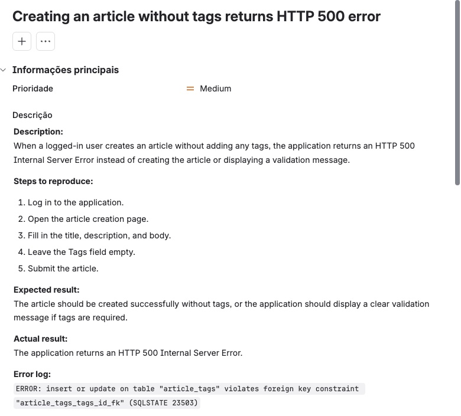

# 02 — Conduit

O [Conduit](https://conduit.mate.academy/) é um clone do Medium (projeto open-source *RealWorld*) usado para treino: cadastro/login, publicação de artigos, comentários, likes/favoritos e seguir usuários. Foi o projeto que acompanhou toda a formação — do plano de teste à API e ao banco de dados.

## Web — planejamento e desenho

- **[Test plan](web/test-plan.md):** escopo por módulo, tipos de teste (smoke, funcional, GUI, compatibilidade, exploratório), riscos e mitigação, critérios de suspensão e de saída, recursos, estimativa e cronograma por sprint.
- **[Decomposição](web/decomposition.md):** decomposição do site para usuário deslogado e logado, usada como estrutura de seções no TestRail.

## TestRail + Jira

- **[Test cases](testrail/test-cases.md):** suíte exportada do TestRail com **120 casos** (Critical 3, High 73, Medium 37, Low 7), organizados pela decomposição.
- **[Test runs](testrail/test-runs.md):** 8 test runs exportados em XML e convertidos.

| Test run | Testes | Passed | Failed |
|---|---|---|---|
| My first Test Run (01/04/2025) | 3 | 3 | 0 |
| Sign Up Test Run (05/04/2025) | 24 | 15 | 9 |
| Sign In Test Run (08/04/2025) | 20 | 17 | 3 |

  As 12 falhas estão vinculadas a **12 bugs no Jira** (projeto `CON`: CON-5, CON-9 a CON-16, CON-20 a CON-22). Os demais 5 runs (smoke, regression, new article, home page e configuration, de 14/04/2025) foram montados com 75 testes no total e aparecem como *untested* no export.
- No Jira: projeto `CON`, épico "Authentication pages redesign", stories Sign In / Sign Up / Home page / Settings / New Article, sprint, e integração TestRail ↔ Jira (referências das stories nos runs e defeitos vinculados aos resultados).

Exemplo de bug reportado no Jira (erro HTTP 500 ao criar artigo sem tags, com o log de erro do banco):

## API — Postman

Ver **[api-postman/](api-postman/)**: collection com **44 requests e 157 checks** (`pm.test`) cobrindo User, Articles, Profile, Tags e Comments, com requests independentes (pre-request scripts que registram usuários e criam dados), cenários positivos e negativos (401/403/404/422) e limpeza dos dados criados.

## SQL

Ver **[sql/](sql/README.md)**: 13 consultas (DDL, DML, `JOIN`, `LEFT JOIN`, `GROUP BY`, subquery) executadas no banco do Conduit, com prints do resultado.

## Ambientes locais

Ver **[ambientes-locais/](ambientes-locais/README.md)**: duas implementações do Conduit rodando localmente (Deno via Docker e Go/Buffalo) para testar com acesso ao banco.

**Habilidades:** test plan, decomposição, TestRail (suítes, runs, export), Jira (stories, épico, sprint, bugs), integração TestRail ↔ Jira, testes de API com Postman, SQL, Docker.
