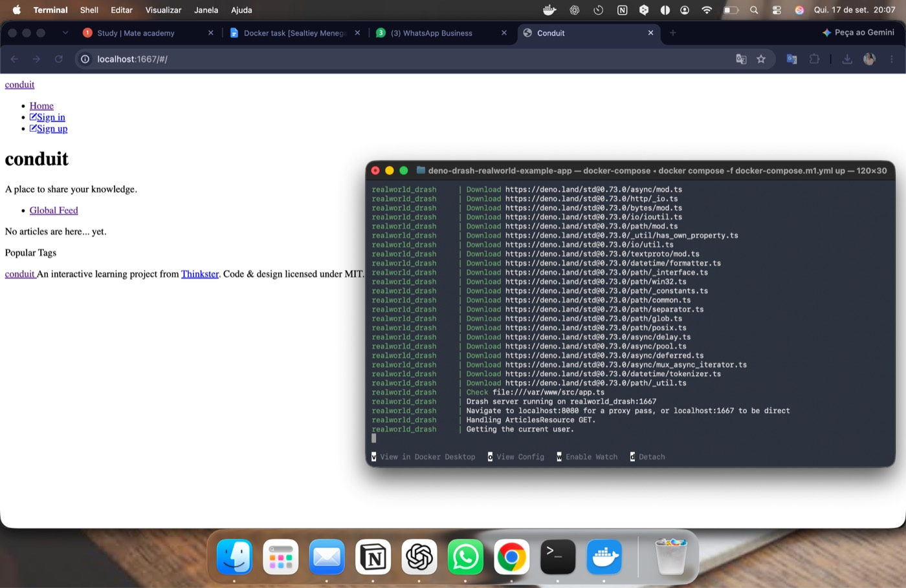
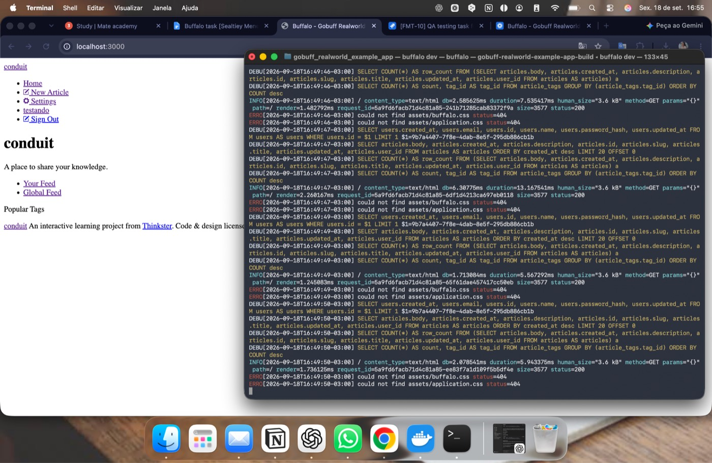

# Ambientes locais do Conduit (Docker e Buffalo)

Para testar com acesso ao banco de dados, subi localmente duas implementações do Conduit (RealWorld) e registrei os bugs encontrados em stories próprias no Jira (`FMT-9` e `FMT-10`, instância privada).

| Implementação | Como foi executada | Endereço local | Story no Jira |
|---|---|---|---|
| Deno + Drash | `docker compose` (app + PostgreSQL) | `localhost:1667` | FMT-9 |
| Go + Buffalo | `buffalo dev` | `localhost:3000` | FMT-10 |

O banco PostgreSQL da versão Deno foi consultado via `psql` dentro do container — ver [SQL](../sql/README.md#deno--join-em-postgresql-psql--docker).

## Deno (Docker) — app rodando em localhost:1667

## Buffalo (Go) — app rodando em localhost:3000

Os logs do servidor mostram as queries SQL executadas e erros 404 de assets (`buffalo.css`, `application.css`).

