# SQL — banco de dados do Conduit

Consultas escritas e executadas contra bancos locais de versões do Conduit (RealWorld). As tarefas foram feitas em DBeaver (SQLite) e em `psql` (PostgreSQL rodando em Docker). Enunciados em inglês, como no original; cada consulta vem com o print do resultado.

**O que mostra:** DDL (`CREATE`/`ALTER`), DML (`INSERT`/`UPDATE`/`DELETE`), filtros com `LIKE` e intervalos de datas, `JOIN`/`LEFT JOIN` entre 2–3 tabelas, `GROUP BY` com `COUNT`, subquery.

## SQL is easy — DDL e DML (DBeaver / SQLite)

Criação e manipulação de uma tabela de reviews.

### 1. Create a new table **reviews_test**.

```sql
CREATE TABLE reviews_test (
  id INTEGER,
  review_name TEXT,
  review_text TEXT,
  review_author_id INTEGER,
  article_id INTEGER
);
```

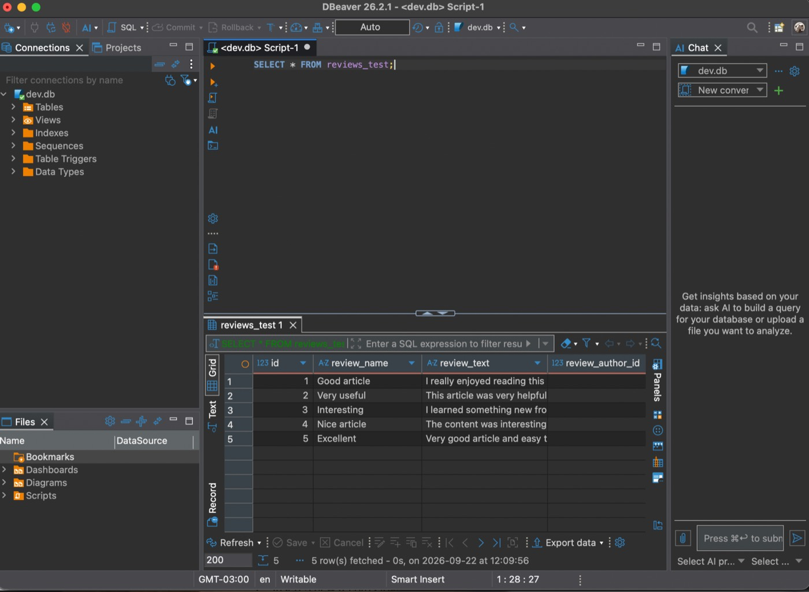

### 2. Insert 5 new records to the **reviews_test** table.

```sql
INSERT INTO reviews_test
  (id, review_name, review_text, review_author_id, article_id)
VALUES
  (1, 'Good article', 'I really enjoyed reading this article.', 1, 1),
  (2, 'Very useful', 'This article was very helpful.', 2, 1),
  (3, 'Interesting', 'I learned something new from this article.', 3, 2),
  (4, 'Nice article', 'The content was interesting and clear.', 4, 3),
  (5, 'Excellent', 'Very good article and easy to understand.', 5, 4);
```

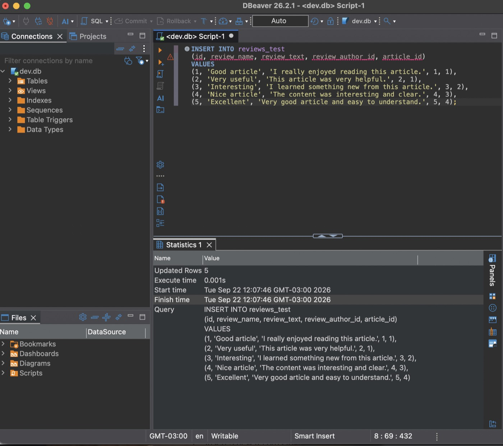

### 3. Select all records from the **reviews_test** table.

```sql
SELECT * FROM reviews_test;
```

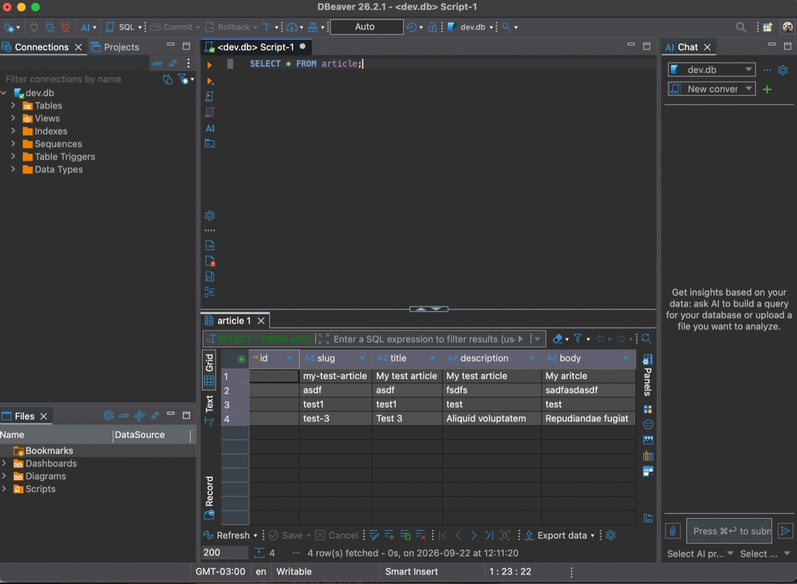

### 4. Select all records from the **article** table.

```sql
SELECT * FROM article;
```

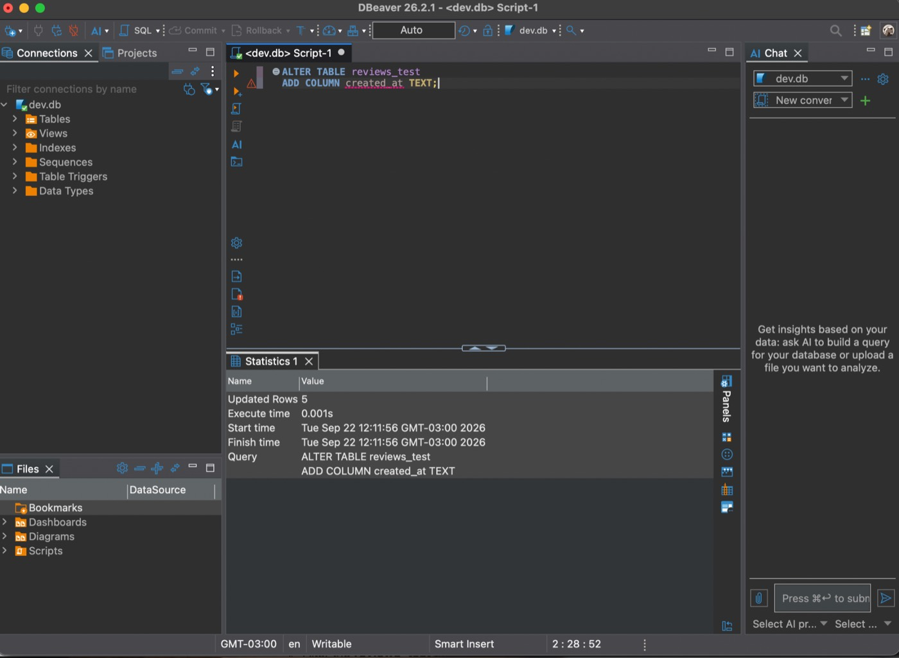

### 5. Alter the **reviews_test** table: add a new column `created_at`.

```sql
ALTER TABLE reviews_test
ADD COLUMN created_at TEXT;
```

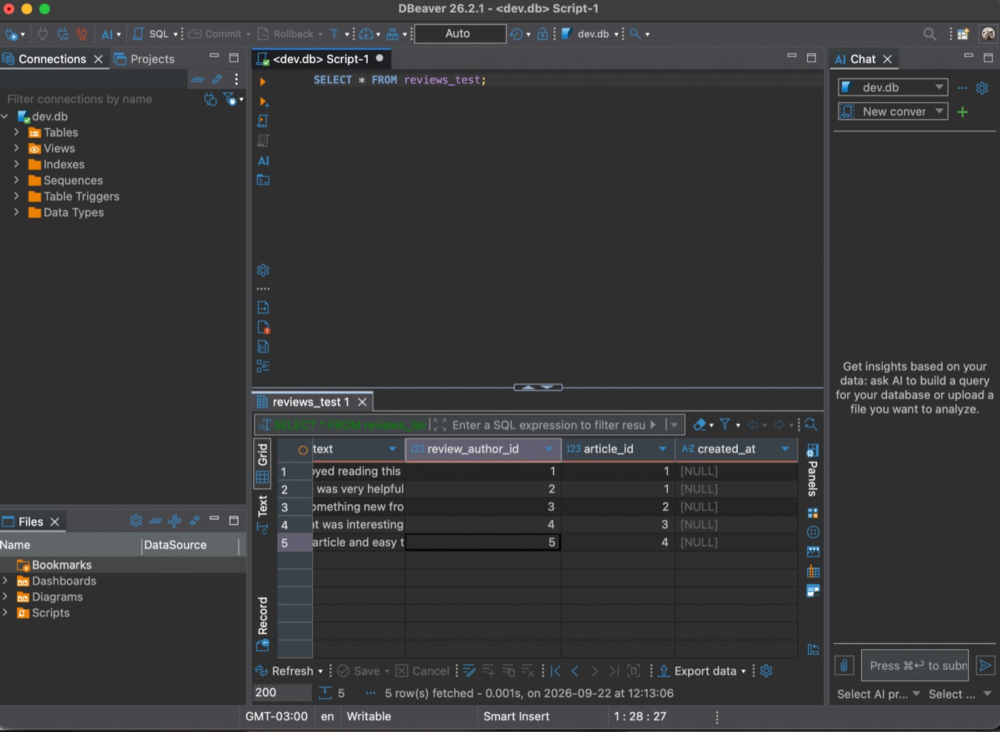

### 6. Update all records in the **reviews_test** table.

```sql
UPDATE reviews_test
SET created_at = '01-01-2222';
```

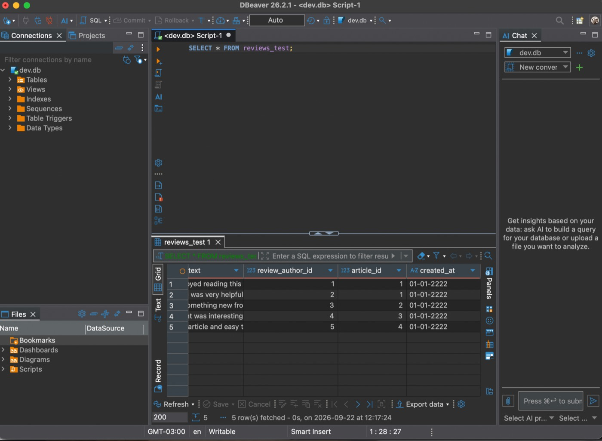

### 7. Delete the last 2 records in the **reviews_test** table.

```sql
DELETE FROM reviews_test
WHERE id IN (
  SELECT id
  FROM reviews_test
  ORDER BY id DESC
  LIMIT 2
);
```

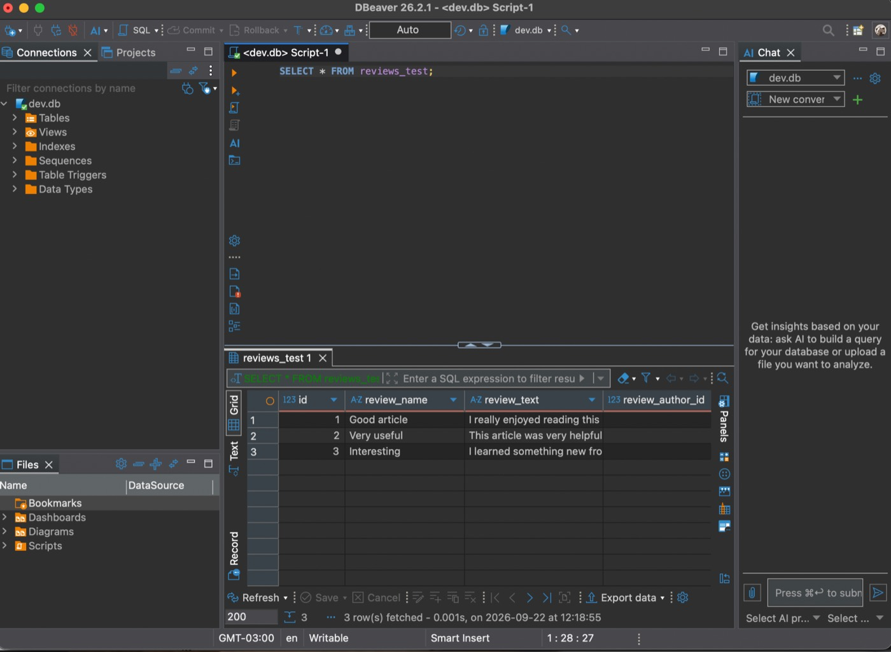

### 8. Create a new table **reviews** (with constraints).

```sql
CREATE TABLE reviews (
  id INTEGER PRIMARY KEY,
  review_name TEXT NOT NULL,
  review_text TEXT NOT NULL,
  review_author_id INTEGER NOT NULL,
  article_id INTEGER NOT NULL
);
```

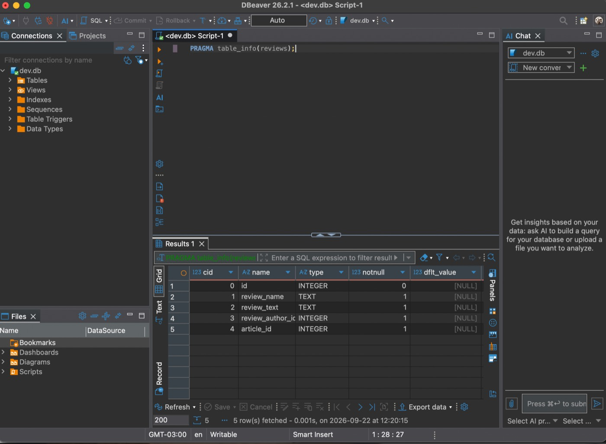

## JOIN is back — consultas com JOIN (DBeaver / SQLite)

Consultas sobre as tabelas `users`, `article` e `favoritor_assoc`.

### 1. Select all **users** whose email does not end with @gmail.com.

```sql
SELECT *
FROM users
WHERE email NOT LIKE '%@gmail.com';
```

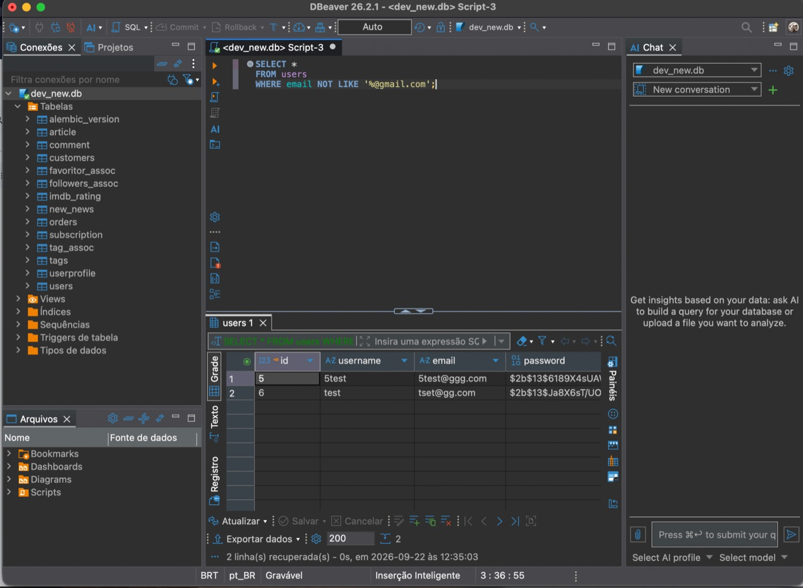

### 2. Select all **articles** written by user `1test` and created between 2020-07-05 and 2020-07-07 (inclusive), ordered by descending created date.

```sql
SELECT a.*
FROM article AS a
JOIN users AS u ON a.author_id = u.id
WHERE u.username = '1test'
  AND a.createdAt >= '2020-07-05'
  AND a.createdAt < '2020-07-08'
ORDER BY a.createdAt DESC;
```

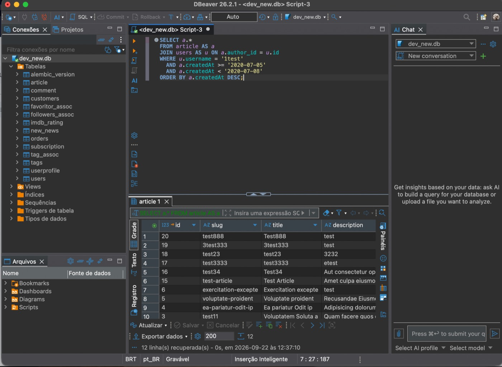

### 3. Select the usernames of **users** and the number of articles written by each user.

```sql
SELECT u.username, COUNT(a.id) AS article_count
FROM users AS u
LEFT JOIN article AS a ON a.author_id = u.id
GROUP BY u.id, u.username;
```

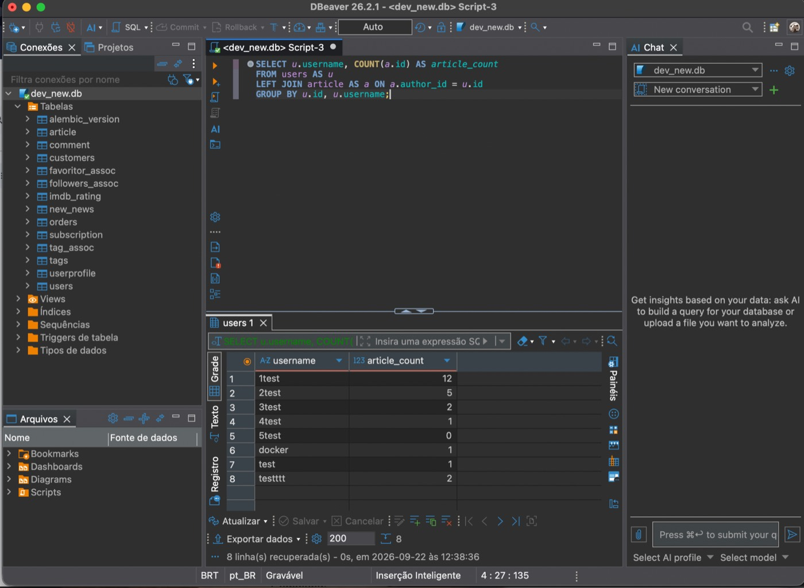

### 4. Select all **users** who have **favorite** articles, printing `username` and `article_title`.

```sql
SELECT u.username, a.title AS article_title
FROM users AS u
JOIN favoritor_assoc AS f ON f.favoriter = u.id
JOIN article AS a ON a.id = f.favorited_article;
```

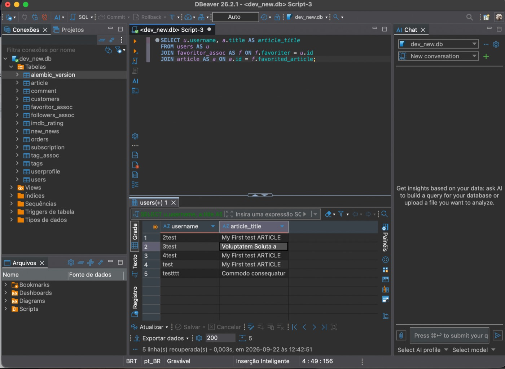

## Deno — JOIN em PostgreSQL (psql / Docker)

Consulta na base da implementação Deno do Conduit.

### 1. Articles with author and comments (three-table JOIN) — PostgreSQL via `psql` no container Docker da app Deno.

```sql
SELECT
  a.title,
  a.tags,
  a.created_at,
  a.updated_at,
  u.username AS "article author",
  c.body AS comment,
  c.author_username AS "comments authors"
FROM articles AS a
JOIN users AS u
  ON a.author_id = u.id
JOIN article_comments AS c
  ON a.id = c.article_id;
```

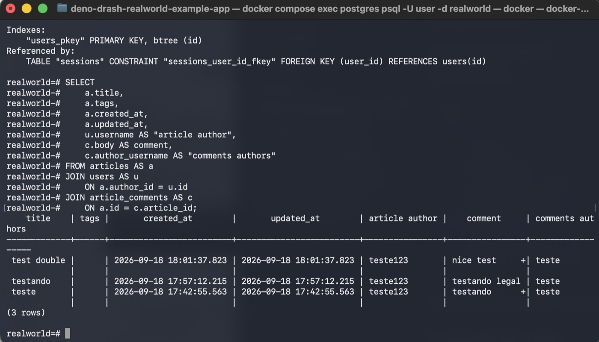
