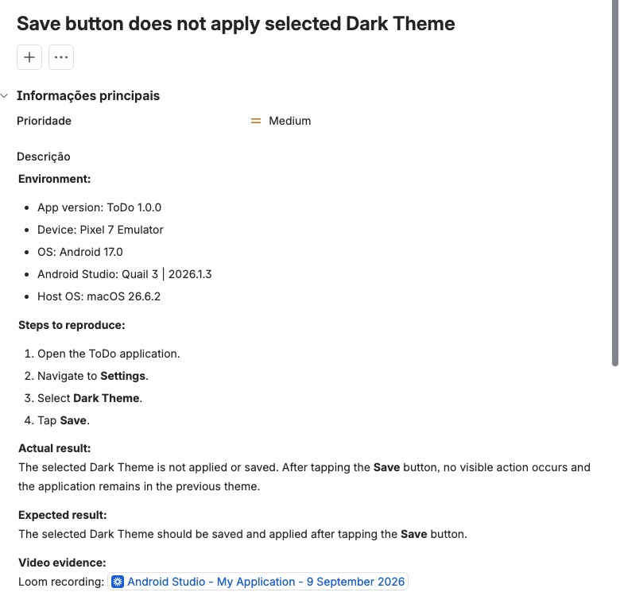

# 04 — Mobile

Testes de aplicações mobile (nativas e web apps no navegador do celular), em emuladores e a partir de mockups.

## Huntd — app mobile

O projeto principal teve um projeto separado para o app mobile: **26 casos de teste, 100% passed** (Login / Authentication, My Chats, Profile, Preferences, Sign Out). Detalhes em [01-huntd](../01-huntd/README.md) e no [test report](../01-huntd/test-report.md#mobile--results-by-feature).

## Tarefas com emuladores e dispositivos

Em cada tarefa, os bugs foram reportados no Jira (instância privada) e vinculados a uma story, seguindo o padrão do curso: ambiente completo (versão do app, device, SO), descrição com "tap" em vez de "click" e gravação de tela com *Show touches* ativado.

| Tarefa | Ferramenta / alvo |
|---|---|
| First Mobile Test | primeiro teste em app mobile |
| Web App mobile | web app no navegador mobile |
| Native Apps | apps nativos |
| Third Mobile Test | app mobile |
| Android Studio | emulador do Android Studio |
| Android Studio Advanced | logs do app de exemplo *Sunflower* no Android Studio |
| Genymotion | emulador Genymotion |

Exemplo de bug reportado no Jira (app ToDo no emulador Pixel 7 / Android Studio):

## Outros exercícios

| Documento | O que tem |
|---|---|
| [mockup-testing.md](mockup-testing.md) | 3 bugs encontrados em um mockup de app mobile, cada um com um caso de teste |
| [short-bug-report.md](short-bug-report.md) | Bug report curto (imagem errada de produto no Swag Labs) |
| [testing-questions.md](testing-questions.md) | Respostas: estratégia de teste a partir de especificação, web × desktop × mobile, bugs críticos no último dia, bug crítico não detectado |

**Habilidades:** testes em emuladores (Android Studio, Genymotion), testes de web app em mobile, bug reports mobile com evidência em vídeo, teste a partir de mockups.
