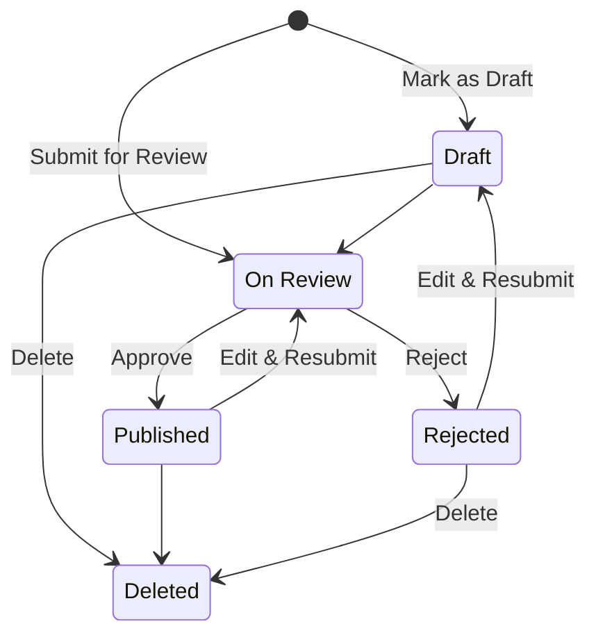

# Diagrama de transição de estados — ciclo de vida de um artigo

Estados e transições de um artigo (rascunho → revisão → publicado/rejeitado → excluído). Arquivo original editável: [`diagramas/state-transition-diagram.drawio`](diagramas/state-transition-diagram.drawio) (abrir em [diagrams.net](https://app.diagrams.net/)). O diagrama abaixo foi redesenhado em Mermaid a partir do arquivo original.

| De | Para | Evento |
|---|---|---|
| Start | Draft | Mark as Draft |
| Start | On Review | Submit for Review |
| Draft | On Review | — |
| Draft | Deleted | Delete |
| On Review | Published | Approve |
| On Review | Rejected | Reject |
| Published | On Review | Edit & Resubmit |
| Published | Deleted | — |
| Rejected | Draft | Edit & Resubmit |
| Rejected | Deleted | Delete |
